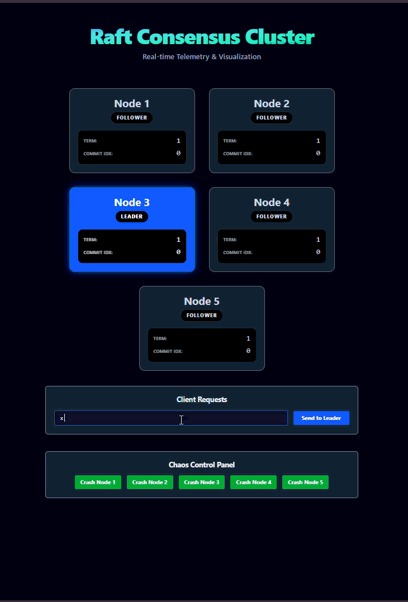

# ⚓ Raft Consensus Cluster

> A high-performance, real-time distributed systems visualizer implementing the Raft Consensus Algorithm from scratch in C++.

 

---

## 📖 Project Overview

The **Raft Consensus Cluster** is an educational yet technically rigorous implementation of the Raft consensus algorithm. Built entirely from scratch without relying on external distributed systems libraries, this project demonstrates how independent nodes in a cluster achieve consensus, elect leaders, and replicate state despite network latency and server crashes. 

What makes this project technically impressive is the underlying **multithreaded architecture**. Each node runs in its own isolated thread, communicating asynchronously via simulated RPCs. The C++ engine serves as the source of truth, broadcasting high-frequency state transitions to a modern React frontend via a dedicated WebSocket telemetry bridge, allowing users to visualize the chaos of distributed systems in real-time.

## ✨ Key Features

- **Multithreaded Leader Election & Heartbeats:** Nodes dynamically transition between Follower, Candidate, and Leader states using randomized election timeouts. Leaders enforce authority by continuously broadcasting `AppendEntries` heartbeats.
- **Real-time Log Replication (Client Mutations):** Users can send client requests to the cluster. The Leader intercepts these payloads, replicates them across the nodes, and commits them once a majority quorum is reached—demonstrating strict state machine replication.
- **Chaos Engineering (Interactive Fault Injection):** A custom UI panel allows users to manually kill and revive specific nodes in-memory. Watch the cluster instantly detect the failure, panic, and securely elect a new Leader to maintain high availability.
- **Real-time WebSocket Telemetry Bridge:** The C++ backend utilizes a lock-free, thread-safe event queue to funnel high-frequency state transitions into a Crow WebSocket server, streaming live telemetry to the browser.

## 🛠 Tech Stack

### Backend (The Consensus Engine)
- **C++17:** Core logic, memory management, and multithreading (`std::thread`, `std::mutex`, `std::condition_variable`).
- **Crow:** Fast C++ microframework used to serve the WebSocket endpoint.
- **JSON:** Native payload serialization for WebSockets.

### Frontend (The Visualizer)
- **React 18 & Vite:** Lightning-fast UI rendering and development server.
- **Redux Toolkit:** Centralized state management to efficiently process high-volume telemetry streams without unnecessary re-renders.
- **Tailwind CSS:** Fully responsive, modern dark-mode UI with smooth micro-animations.
- **TypeScript:** Strict type safety across the frontend architecture.

## 🏛 System Architecture

At its core, the backend spins up 5 isolated `Node` threads. Each node maintains its own volatile and persistent Raft state (Current Term, Voted For, Log Entries, Commit Index). Nodes communicate with each other using fire-and-forget lambda functions that simulate `RequestVote` and `AppendEntries` RPCs over a virtual network with injected latency.

To decouple the intense consensus logic from the network I/O, nodes push `RaftStateEvent` structs into a global **Thread-Safe Queue**. A dedicated consumer thread constantly pulls from this queue, serializes the events into JSON, and broadcasts them out to all connected React clients via the Crow WebSocket server.

## 🚀 Local Setup & Installation

### Prerequisites
- `g++` (MinGW-w64 on Windows or native GCC on Linux/macOS)
- `Node.js` (v18+)
- `npm`

### 1. Compile & Run the C++ Backend
The backend utilizes the header-only `crow_all.h` for seamless compilation.

```bash
# Navigate to the backend directory
cd backend

# Compile the C++ engine (Windows Example)
g++ -I./src -I./asio-asio-1-28-0/asio/include -o raft_simulator.exe src/main.cpp src/raft_core/Node.cpp -lpthread -lws2_32 -lwsock32

# Run the server
./raft_simulator.exe
```
*(The server will boot and listen for WebSocket connections on `ws://localhost:8080/raft`)*

### 2. Start the React Frontend
Open a new terminal window to spin up the UI.

```bash
# Navigate to the frontend directory
cd frontend

# Install dependencies
npm install

# Start the Vite development server
npm run dev
```

Visit `http://localhost:5173` in your browser. Send some client requests and try crashing the Leader to see Raft in action!
