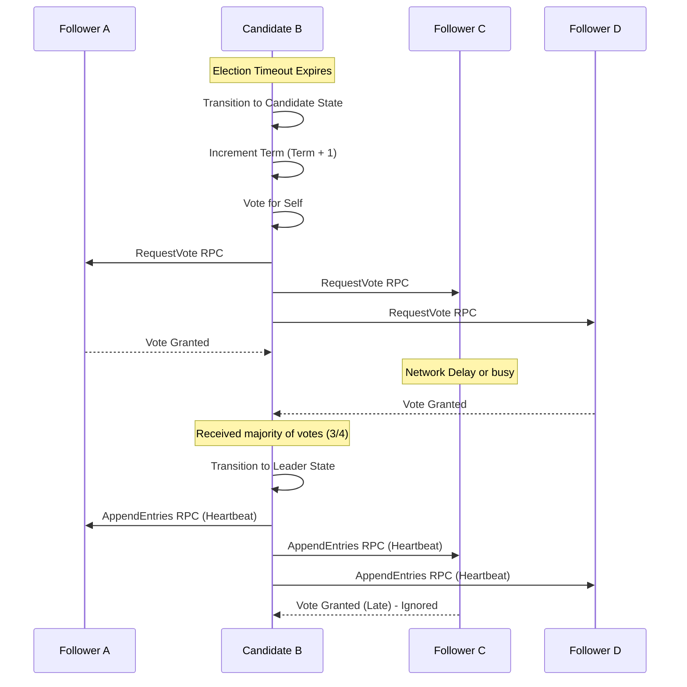

# Raft Consensus Algorithm: Visualized Simulator

## Project Pitch
This project is a highly bounded, custom implementation of the Raft Consensus Algorithm engineered to demonstrate mastery over distributed systems, multithreading, and real-time state visualization. Built from the ground up using modern C++17, the backend simulates a 5-node cluster handling complex race conditions, split-brain scenarios, and strict leader election through robust thread synchronization (using `std::mutex` and `std::condition_variable`). A React-Redux dashboard bridges the gap via a high-throughput WebSocket telemetry stream, allowing users to inject "Chaos" events (e.g., node crashes or network partitions) and observe the system's resilience and self-healing capabilities in real time.

## User Review Required

> [!IMPORTANT]
> Please review this architectural blueprint and roadmap. Once approved, we will proceed to Phase 1 (Core Raft Logic). 

## Open Questions

> [!NOTE]
> 1. Which WebSocket library do you prefer for the C++ backend? (e.g., uWebSockets, Crow, or Boost.Beast). Crow is very easy to set up for a C++ telemetry server.
> 2. For the React frontend, are you comfortable with Vite and TypeScript, or do you prefer standard JavaScript?
> 3. Do you have a preference for the C++ build system? (CMake is recommended and standard).

## System Architecture

```mermaid
flowchart TD
    %% Define styles
    classDef cpp fill:#2b3a42,stroke:#3f5765,stroke-width:2px,color:#fff
    classDef react fill:#61dafb,stroke:#282c34,stroke-width:2px,color:#000
    classDef queue fill:#e06c75,stroke:#282c34,stroke-width:2px,color:#fff

    subgraph C++ Backend (Multithreaded Simulator)
        Node1((Node 1)):::cpp
        Node2((Node 2)):::cpp
        Node3((Node 3)):::cpp
        Node4((Node 4)):::cpp
        Node5((Node 5)):::cpp
    end

    subgraph Telemetry Bridge
        TS_Queue[(Thread-Safe Event Queue)]:::queue
        WSServer[WebSocket Server]:::cpp
    end

    subgraph Frontend
        ReactUI[React & Redux Dashboard]:::react
    end

    %% Internal Node Communication
    Node1 <.RPC.> Node2 & Node3 & Node4 & Node5
    Node2 <.RPC.> Node3 & Node4 & Node5
    Node3 <.RPC.> Node4 & Node5
    Node4 <.RPC.> Node5

    %% Telemetry Flow
    Node1 & Node2 & Node3 & Node4 & Node5 -- State Changes / Logs --> TS_Queue
    TS_Queue -- Poll / Consume --> WSServer
    WSServer == JSON Payloads ==> ReactUI

    %% Chaos Flow
    ReactUI -- Chaos Commands (Crash, Disconnect) --> WSServer
    WSServer -- Dispatched Events --> Node1 & Node2 & Node3 & Node4 & Node5
```

## Sequence Diagram: Leader Election



## Proposed File Structure

```text
raft-simulator/
├── README.md
├── .gitignore
├── backend/                  # C++ Telemetry & Core Logic
│   ├── CMakeLists.txt
│   ├── src/
│   │   ├── main.cpp          # Entry point, initializes nodes and WebSocket server
│   │   ├── raft_core/
│   │   │   ├── Node.h
│   │   │   ├── Node.cpp
│   │   │   ├── StateMachine.h
│   │   │   └── Types.h       # Enums (State, Roles) and Structs (LogEntry, RPC)
│   │   └── telemetry/
│   │       ├── ThreadSafeQueue.h
│   │       ├── WebSocketServer.h
│   │       └── WebSocketServer.cpp
│   └── tests/
│       └── ...
└── frontend/                 # React & Redux Dashboard
    ├── package.json
    ├── vite.config.ts
    ├── src/
    │   ├── main.tsx
    │   ├── App.tsx
    │   ├── store/
    │   │   ├── store.ts
    │   │   └── raftSlice.ts  # Redux slice strictly mirroring C++ state payloads
    │   ├── components/
    │   │   ├── ClusterView.tsx
    │   │   ├── NodeCard.tsx
    │   │   ├── LogReplicationView.tsx
    │   │   └── ChaosControlPanel.tsx
    │   └── utils/
    │       └── websocket.ts
    └── public/
```

## Development Roadmap

### Phase 1: Core Raft Logic (C++ Backend)
- Set up CMake project and basic project structure.
- Define `Node` class and state transitions (Follower, Candidate, Leader).
- Implement election timers, RequestVote RPC simulation using threads, and `std::mutex` for thread-safe state access.
- Implement the Thread-Safe Event Queue to buffer telemetry events.

### Phase 2: Log Replication & Heartbeats (C++ Backend)
- Implement AppendEntries RPC for regular heartbeats to maintain leadership.
- Add client request simulation (appending to the leader's log).
- Replicate log entries to followers and commit upon majority consensus.

### Phase 3: Telemetry Bridge (C++ Server & React Boilerplate)
- Integrate a C++ WebSocket library (e.g., Crow).
- Establish the consumer thread that pops from the Thread-Safe Event Queue and broadcasts JSON telemetry payloads to connected clients.
- Scaffold the React/Vite application with Redux and establish the WebSocket client connection.

### Phase 4: Visualization & Chaos Engineering (React Frontend)
- Build the `ClusterView` and `NodeCard` components to visualize real-time state, term numbers, and logs.
- Implement the `ChaosControlPanel` to dispatch commands via WebSockets back to the backend (e.g., simulate a node crash or network partition).
- Polish the UI with animations and dynamic styling for a premium feel.

## Verification Plan
- **Phase 1-2:** CLI testing and debug logging to ensure standard Raft leader election and log replication work accurately under normal conditions.
- **Phase 3:** Confirm JSON payloads are successfully transmitted over the WebSocket without dropping events under high throughput.
- **Phase 4:** Manual end-to-end verification. Inject Chaos commands from the React UI and observe the visual recovery of the system state (e.g., a new leader is elected).
